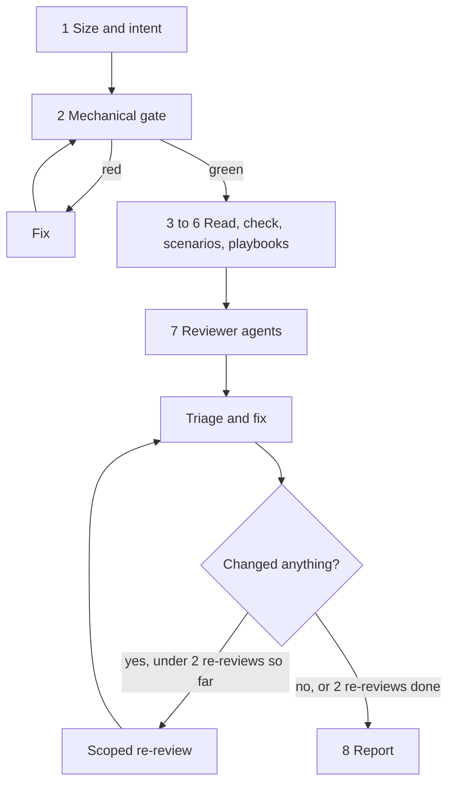

# Reviewing Skills

A skill reads well to its author and then gets argued around, misread or never triggered. Review the whole skill directory as an agent who has never seen it, and as a reviewer who did not write it. The aim is a skill that changes agent behavior, with a stronger wording attached to every defect found.

The standard the review applies is the `skill-principles` skill. Load it for step 3. This skill is the process: what to run, which reviewers to dispatch, how to write findings, and how to prove the skill works.

## Procedure

Do the steps in order. Fix problems as you find them, then rerun step 2 when you finish.

1. **Size and intent.** State in one sentence what behavior the skill should change and for whom, and name its kind (discipline, workflow, doc-wrapper, router, reference catalog, command or hook, agent pipeline). A skill that cannot be summarized this way is not ready for review. When a change to a skill passes about 400 hand-written lines or 200,000 diff characters, split it along a seam first.
2. **Mechanical gate.** Run `bun <base directory>/scripts/skill-check.ts <skill-dir>`. It costs no LLM tokens. Fix every FAIL before reading further, and list SKIPPED checks under gate gaps. Detail: [references/mechanical-gate.md](references/mechanical-gate.md).
3. **Read against `skill-principles`**, in order: routing and description, authority, rationalization, specificity and contradictions, examples, diagrams, pipelines. How to read and write up findings: [references/review-guide.md](references/review-guide.md).
4. **Check what the files cannot show.** Sibling skills with overlapping triggers, project rules the skill contradicts (`CLAUDE.md`, `AGENTS.md`), commands and scripts it calls, and every claim about a library, API or standard, verified against current docs.
5. **Pressure scenarios.** Baseline versus skill, a negative control, and an adversarial combined-pressure case, on fresh Sonnet agents. Off by default inside `/self-review`, on with `--scenarios` in `/review-skill`. Format and verdict rules: [references/pressure-scenarios.md](references/pressure-scenarios.md).
6. **Matching playbooks.** Name the kind of skill, open [references/playbooks/index.md](references/playbooks/index.md), and apply only the playbooks it points to.
7. **Reviewer agents.** Dispatch fresh reviewers in parallel from the prompt templates in [references/review-runbook.md](references/review-runbook.md), each on `model: sonnet`, and triage what they return.
8. **Report.** Print the block with `bun <base directory>/scripts/report.ts` (run it with `--help`). Never write the block by hand.

## Reviewers

| Role | Dispatch when | Looks for |
|---|---|---|
| instruction-quality | always | authority, rationalization risk, contradictions, vagueness, diagrams, hedged gates |
| content | references or scripts changed | a per-file promise ledger: prose claims checked against the file's own code, external claims handed off |
| routing and overlap | a description changed or a skill was added | trigger precision, sibling collisions, reverse exclusions, registry rows |
| pipeline | the skill dispatches agents | roles, models, handoffs, verdict words, round caps, escalation |
| claim verifier | any reviewer handed off a claim | a quoted check result for each external or runtime claim, or a stated failed attempt |

A skill with more than 4 reference files gets the content reviewer as shards of at most 4 files each, every shard also reading SKILL.md. Shards hand external claims off to a separate claim verifier that runs the checks and quotes the results. Shards and verifier are one role, so they use one slot of the 6-reviewer cap in `/self-review`; findings are merged and de-duplicated by location. Every reviewer ends with a `coverage:` line, and any unread file is a gap. Without a subagent tool (Codex, Gemini), run the roles one after another in a single session and reread the files for each. The runbook has the dispatch line for each platform and the fallback.

## Red flags

Stop and go back to the step if you catch yourself thinking any of these.

| Thought | Reality |
|---|---|
| "The gate is green, so the skill is fine." | The gate checks form. It cannot see a rule worded as a suggestion or a missing defense. Steps 3 to 7 are the review. |
| "I wrote it, so I know what it means." | The reader is an agent with none of your context. Hand reviewers file paths only, never your reasoning. |
| "That `should` is probably fine." | Decide from the stakes. A rule agents break under pressure needs a gate and a defense. A low-stakes preference does not need either. |
| "A reviewer said it is wrong, so I fix it." | Reviewers are wrong often enough. Read the cited line, then fix, decline with `file:line`, or defer. |
| "It reads clearly, no scenario needed." | A skill is tested like code. Without a baseline run, nobody knows the skill changed anything. |

## Inside /self-review

`reviewing-code` runs this skill whenever a diff adds or edits any file under `skills/`. The wiring is Claude-only; the skill works the same elsewhere when invoked by name.

- Step 1 of the runbook also runs `skill-check` on each touched skill.
- Step 2 dispatches the reviewers alongside `code-reviewer`. They count toward the cap of 6, and `code-reviewer` still runs on a skills-only diff.
- The instruction-quality reviewer is always kept, at the same priority as `code-reviewer`. The content reviewer runs when references or scripts changed. The routing reviewer runs when a description changed or a skill was added. The pipeline reviewer runs only when the skill dispatches agents.
- The 20-line count covers lines changed under `skills/**`, excluding the registry files (`SKILLS.md`, `README.md`). Below 20 lines, run only the gate and the instruction-quality reviewer, plus the routing reviewer when a description changed. A changed description overrides the count.
- When the cap forces drops, drop these after `agent-evaluator` and `type-design-analyzer` and before the language reviewers, in this order: pipeline, routing, content.
- Pressure scenarios stay off unless asked.

## References

Load only what the step needs.

- [references/review-runbook.md](references/review-runbook.md): the runbook, the four reviewer prompt templates, triage and fix rules, the sequential fallback, dispatch lines per platform. Steps 5 to 8.
- [references/mechanical-gate.md](references/mechanical-gate.md): what `skill-check` runs, how to read each result, what a gate gap is. Step 2.
- [references/review-guide.md](references/review-guide.md): how to read a skill and write up findings. Steps 1, 3 and 4.
- [references/pressure-scenarios.md](references/pressure-scenarios.md): scenario kinds, the results table, the major-finding rules. Step 5.
- [references/playbooks/index.md](references/playbooks/index.md): one playbook per kind of skill. Step 6.
- [references/checklist.md](references/checklist.md): the condensed final pass.
- [references/worked-example.md](references/worked-example.md): one complete review, for calibrating tone and content.
- The `skill-principles` skill: `references/principles.md` for step 3.
