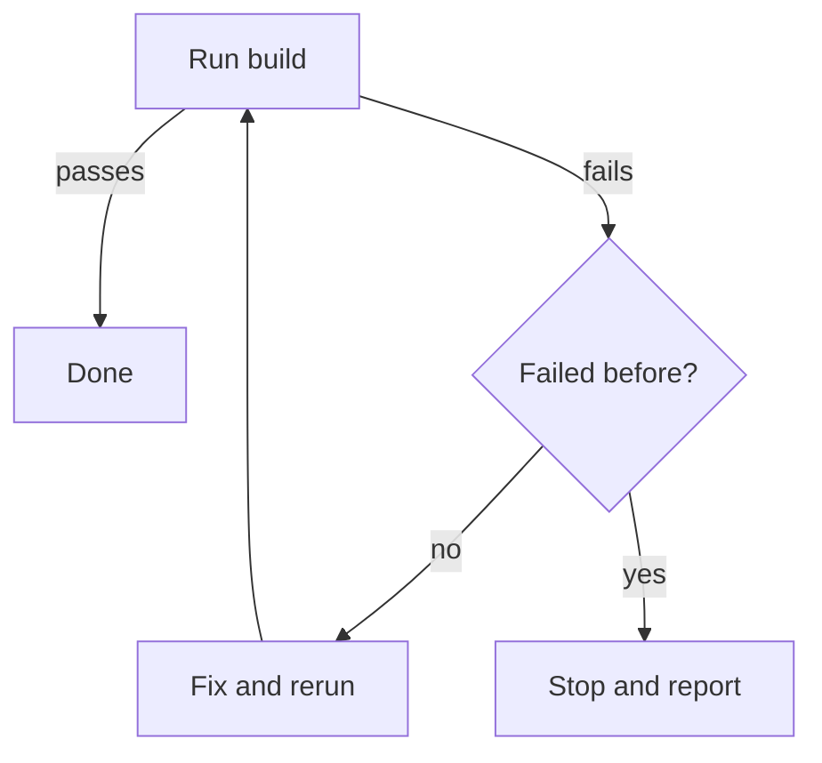

# Skill Principles

> This repo is the source for this file. To check a finished skill against these principles, use the `reviewing-skills` skill. To create a skill in this repo (naming, registration, doc fetching), use `authoring-agent-skills`.

A skill is instructions an agent reads under pressure, with no chance to ask what you meant. These ten principles say what makes those instructions work. Each section gives the principle, what a violation looks like, and a short Wrong and Right pair.

Sources, restated here in this repo's words and cited by path so the standard stays usable offline:

- `skills/authoring-agent-skills` and `skills/agent-instructions` (this repo)
- `skills/best-practices-for-agentic-development/references/skill-development.md` (this repo)
- `superpowers:writing-skills` and its references (`testing-skills-with-subagents.md`, `bulletproofing.md`, `persuasion-principles.md`, `discovery.md`, `flowcharts.md`), read from the Superpowers plugin; repo at [obra/superpowers](https://github.com/obra/superpowers)
- ECC at [affaan-m/ECC](https://github.com/affaan-m/ECC): `docs/SKILL-DEVELOPMENT-GUIDE.md`, `skill-stocktake`, `skill-comply`

The persuasion reference quotes compliance figures from a study. They are not verified here, so this standard does not repeat them.

## Which principles apply

Principles 3 to 7 and 10 apply to every skill. Principles 1, 2, 8 and 9 apply to discipline skills, workflow skills and agent pipelines. A doc-wrapper or reference catalog is not flagged for a missing rationalization table.

## One authority vocabulary

Rate how strongly a rule binds with exactly three words.

- **gate**: the agent must not proceed until the rule is met.
- **guidance**: the agent should follow it and may deviate with a stated reason.
- **informational**: context, no obligation.

The devices in principle 1 (prohibition, positive recipe, template slot, predicate) are how a gate or guidance is written. They are not a second scale. A finding that says a rule's current or recommended authority names one of these three words.

## Severity vocabulary

Findings use blocker, major, minor or nit, the same words as `reviewing-code`.

- **blocker**: the skill misleads agents or cannot be loaded; do not ship.
- **major**: a defect agents will hit in normal use.
- **minor**: a real but low-impact defect.
- **nit**: taste, optional.

## The `fragment` marker

The mechanical gate in `reviewing-skills` extracts fenced code blocks and checks them: Python and TypeScript are type-checked, bash gets `bash -n`, JSON is parsed. A deliberately partial teaching snippet opts out by putting `# fragment` (or `// fragment` in TypeScript) on the first line of the block. The marker must be the first line; anywhere else the block is checked. A fence with an unknown or missing language tag is ignored, not failed.

---

## 1. Authority matches stakes

Choose the device by the kind of failure you are preventing, then ration the strongest wording.

| Failure | Device |
|---|---|
| A rule agents break under pressure | A prohibition plus a rationalization table (principle 2) |
| The output has the wrong shape | A positive recipe: show the shape |
| An element gets omitted | A required slot in a template |
| Behavior depends on a condition | A predicate the agent can evaluate |

MUST, NEVER and the heavy gates (an "Iron Law" section, a HARD-GATE block) cost attention every time they appear. Superpowers observed that its best skills use between zero and two of them, which is an observation about those skills, not a rule here. Reserve a heavy gate for a rule whose violation is expensive. Do not add nuance clauses that let the agent talk itself out of a gate.

**Wrong**

```text
You should probably run the tests before committing, and it might be worth
checking the lint output too. Never skip verification (unless you are in a
hurry, in which case it can be skipped).
```

Hedged wording on something that is meant to be a gate, plus a clause that cancels the prohibition.

**Right**

```text
Run `make test` before every commit. Do not commit while it fails.
```

A single prohibition with an observable condition. If a real exception exists, state it as its own predicate ("a docs-only change skips `make test`") instead of a nuance clause.

## 2. Instructions survive rationalization

Agents under pressure invent reasons the rule does not apply. A skill meant to hold must anticipate them: a table of excuse and reality, a Red Flags list of thoughts that signal the agent is about to break the rule, and loophole closers that say what a word means ("deleting means deleting, not keeping it as reference"). Build the table from excuses seen in baseline runs, and add to it when a new one appears in testing. A mature discipline skill has these; their absence usually means nobody has watched an agent fail with it yet.

**Wrong**

```text
Always write the failing test first.
```

No defense. The first time the change is "too small to need one," the rule is gone.

**Right**

```text
Always write the failing test first.

| Excuse | Reality |
|---|---|
| "It is too small to test." | Small changes break too. The test takes a minute. |
| "I will add the test after." | A test written after passes immediately and proves nothing. |

Red flags: "just this once", "I already know it works", "the deadline".
```

## 3. Specific and consistent

Give each rule one threshold, one owner and an observable trigger for each condition. "Keep it short" is not a threshold; "under 400 characters" is. Two rules in different places must not disagree: check `SKILL.md` against its references, against sibling skills, and against the project rules (`CLAUDE.md`, `AGENTS.md`). When two sources say different things the agent picks one at random, so a contradiction is a defect even when each side reads fine alone.

**Wrong**

```text
SKILL.md:        Never open a PR before running /self-review.
references/pr.md: In an emergency, skip the review and open the PR directly.
```

**Right**

```text
SKILL.md:        Run /self-review before opening a PR.
references/pr.md: A hotfix that reverts a deploy skips /self-review. Nothing else does.
```

The exception is a predicate, stated once, and the rule it modifies names it.

## 4. The description is a trigger

The `description` frontmatter field decides whether the skill loads. Write it as conditions under which to use the skill: "Use when...", third person, with triggers the user or situation actually produces. Never summarize what the skill does step by step. Superpowers found that when a description outlines the workflow, agents follow the description and skip the body. Add "Not for X (use Y)" exclusions that point to sibling skills, and make the sibling's description point back. This repo caps descriptions at 400 characters (`make lint-descriptions`).

**Wrong**

```text
description: Walks the agent through read, reproduce, hypothesize, test and fix
  phases to debug a failing test.
```

It summarizes the workflow, names no trigger, and has no exclusions.

**Right**

```text
description: Use when a test fails or behavior is unexpected, before proposing a
  fix. Not for reviewing a finished diff (use reviewing-code).
```

## 5. Progressive disclosure

The body of `SKILL.md` is read on every load, so keep it short and make it route: "read X when Y." Put detail in `references/` for on-demand reading. Do not force-load files with `@path` imports, which pull the whole file into context whether it is needed or not. Keep `SKILL.md` well under 20,000 bytes. Do not set line-count targets for references; write what the content needs, since line count is only a rough proxy for complexity. Every reference should be reachable from a link in `SKILL.md` or another routed file, or nothing will ever open it.

**Wrong**

```text
@references/all-the-rules.md
@references/every-example.md
```

**Right**

```text
| You are... | Read |
|---|---|
| Writing a description | [descriptions.md](references/descriptions.md) |
| Splitting a long skill | [layout.md](references/layout.md) |
```

## 6. Flow made visible

A diagram earns its place when a decision is non-obvious or a loop can stop early, because prose hides branches. Reference material, code and linear steps do not need one. Mermaid is the default in this repo; Graphviz or ASCII are acceptable if used consistently within a skill. Put real labels on nodes and keep code out of the diagram.

**Wrong**

A numbered list that says "if the build fails go back to step 2, unless it failed twice, then go to step 6, otherwise continue."

**Right**



## 7. Examples teach

One excellent example beats several mediocre ones. Show paired good and bad versions, vary them enough that the agent learns the principle and not the surface, and keep them runnable and checked (the mechanical gate checks fenced code unless it carries the `fragment` marker). Avoid a narrative example about one past session, and avoid the same example in five languages.

**Wrong**

Three near-identical snippets in Python, JavaScript and Go, one of which no longer compiles.

**Right**

One checked snippet in the language the skill's users write, with a bad version beside it and one sentence on why the bad one fails.

## 8. Evidence over belief

Test a skill the way you test code. Run a fresh agent on a pressure scenario without the skill (RED) and record how it fails. Write the skill to address those failures. Run it again with the skill (GREEN) and confirm each failure changed. Then run a combined-pressure scenario to look for new loopholes, and a control scenario that should not trigger the skill, to catch over-triggering. This is the loop in `superpowers:writing-skills` and `testing-skills-with-subagents.md`; `reviewing-skills` carries the scenario format.

**Wrong**

"I read it over and it looks clear, so I shipped it."

**Right**

"Baseline agent summarized the workflow in its description. With the skill loaded, three of three scenarios produced a trigger-only description. The control scenario did not load the skill."

## 9. Agent pipelines are specified

A skill that dispatches other agents must say who does what. Name each role and the model it runs on, the handoff files between them, and a fixed verdict vocabulary so the parent can branch on the result. Say how a re-review is scoped (only the fixed items), how many rounds are allowed and what breaks the loop, and when to escalate. Workers do not dispatch further agents; the parent owns collection. The Superpowers `subagent-driven-development` skill is the reference pattern.

**Wrong**

```text
Spawn a reviewer, fix what it finds, and review again until it is happy.
```

No model, no verdict words, no cap, so it can loop forever.

**Right**

```text
Reviewer (Sonnet) writes findings to review.md and ends with READY or NOT READY.
Re-review checks only items marked fixed. After three rounds, stop and report
the open findings. Reviewers do not dispatch other agents.
```

## 10. Verification is built in

A skill that claims an outcome must include a check the agent runs and a reviewer can rerun: a command, a lint, a test, an assertion. "Make sure it works" is a wish. The check should fail when the outcome is false, and its output should be what the agent reports.

**Wrong**

```text
When done, confirm the skill is well formed.
```

**Right**

```text
When done, run `make lint-descriptions` and report its output. A non-zero exit
means the skill is not done.
```
